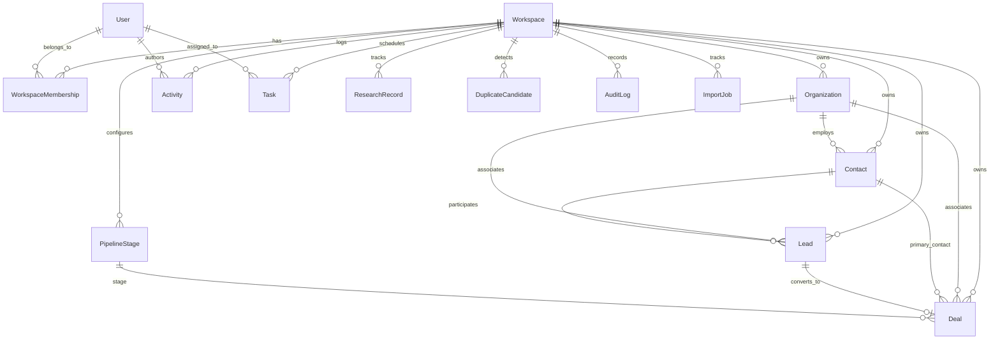

# VENDRE — Database Schema Documentation

## 1. Relational Entity Relationship Diagram

---

## 2. Entity Definitions & Column Specifications

### 2.1 `User`
Stores authenticated users in the system.
- `id` (UUID, Primary Key)
- `email` (VarChar 255, Unique, Indexed)
- `name` (VarChar 255)
- `passwordHash` (Text)
- `isActive` (Boolean, Default true)
- `createdAt` (Timestamp with timezone)
- `updatedAt` (Timestamp with timezone)

### 2.2 `Workspace`
Top-level business partitions ("VENDRE Sales", "Agency Sales").
- `id` (UUID, Primary Key)
- `name` (VarChar 255)
- `slug` (VarChar 100, Unique, Indexed)
- `createdAt` (Timestamp with timezone)
- `updatedAt` (Timestamp with timezone)

### 2.3 `WorkspaceMembership`
Maps users to workspaces with assigned RBAC roles.
- `id` (UUID, Primary Key)
- `userId` (UUID, FK -> User.id, On Delete Cascade)
- `workspaceId` (UUID, FK -> Workspace.id, On Delete Cascade)
- `role` (Enum: `OWNER`, `ADMIN`, `MANAGER`, `SALES`, `VIEW_ONLY`)
- `createdAt` (Timestamp with timezone)
- `updatedAt` (Timestamp with timezone)
- Unique Constraint: `(userId, workspaceId)`

### 2.4 `Organization`
Accounts and companies managed within a workspace.
- `id` (UUID, Primary Key)
- `workspaceId` (UUID, FK -> Workspace.id, Indexed)
- `name` (VarChar 255, Indexed)
- `website` (VarChar 255, Nullable)
- `industry` (VarChar 100, Nullable)
- `country` (VarChar 100, Nullable)
- `city` (VarChar 100, Nullable)
- `phone` (VarChar 50, Nullable)
- `email` (VarChar 255, Nullable)
- `address` (Text, Nullable)
- `description` (Text, Nullable)
- `ownerId` (UUID, FK -> User.id, Nullable)
- `createdById` (UUID, FK -> User.id)
- `createdAt` (Timestamp with timezone)
- `updatedAt` (Timestamp with timezone)
- Indexes: `(workspaceId, name)`, `(workspaceId, industry)`, `(workspaceId, createdAt)`

### 2.5 `Contact`
Individual persons associated with organizations or deals.
- `id` (UUID, Primary Key)
- `workspaceId` (UUID, FK -> Workspace.id, Indexed)
- `organizationId` (UUID, FK -> Organization.id, Nullable, On Delete Set Null)
- `firstName` (VarChar 100)
- `lastName` (VarChar 100)
- `jobTitle` (VarChar 150, Nullable)
- `email` (VarChar 255, Nullable, Indexed)
- `phone` (VarChar 50, Nullable, Indexed)
- `whatsApp` (VarChar 50, Nullable)
- `country` (VarChar 100, Nullable)
- `city` (VarChar 100, Nullable)
- `linkedInUrl` (VarChar 255, Nullable)
- `notes` (Text, Nullable)
- `ownerId` (UUID, FK -> User.id, Nullable)
- `createdById` (UUID, FK -> User.id)
- `createdAt` (Timestamp with timezone)
- `updatedAt` (Timestamp with timezone)
- Indexes: `(workspaceId, email)`, `(workspaceId, organizationId)`

### 2.6 `Lead`
Prospective sales opportunities.
- `id` (UUID, Primary Key)
- `workspaceId` (UUID, FK -> Workspace.id, Indexed)
- `title` (VarChar 255)
- `contactId` (UUID, FK -> Contact.id, Nullable, On Delete Set Null)
- `organizationId` (UUID, FK -> Organization.id, Nullable, On Delete Set Null)
- `source` (VarChar 100, Default 'Inbound')
- `status` (Enum: `NEW`, `CONTACTED`, `QUALIFIED`, `UNQUALIFIED`, `CONVERTED`, Default `NEW`)
- `priority` (Enum: `LOW`, `MEDIUM`, `HIGH`, `URGENT`, Default `MEDIUM`)
- `estimatedValue` (Decimal(15,2), Default 0.00)
- `expectedCloseDate` (Date, Nullable)
- `nextFollowUp` (Date, Nullable)
- `description` (Text, Nullable)
- `ownerId` (UUID, FK -> User.id, Nullable)
- `createdById` (UUID, FK -> User.id)
- `convertedDealId` (UUID, FK -> Deal.id, Nullable, Unique)
- `createdAt` (Timestamp with timezone)
- `updatedAt` (Timestamp with timezone)
- Indexes: `(workspaceId, status)`, `(workspaceId, ownerId)`

### 2.7 `PipelineStage`
Configurable stages for sales deals within each workspace.
- `id` (UUID, Primary Key)
- `workspaceId` (UUID, FK -> Workspace.id, Indexed)
- `name` (VarChar 100)
- `displayOrder` (Integer)
- `color` (VarChar 30, Default '#3B82F6')
- `isWon` (Boolean, Default false)
- `isLost` (Boolean, Default false)
- `createdAt` (Timestamp with timezone)
- `updatedAt` (Timestamp with timezone)
- Unique: `(workspaceId, displayOrder)`, `(workspaceId, name)`

### 2.8 `Deal`
Qualified sales transactions advancing through pipeline stages.
- `id` (UUID, Primary Key)
- `workspaceId` (UUID, FK -> Workspace.id, Indexed)
- `title` (VarChar 255)
- `stageId` (UUID, FK -> PipelineStage.id, On Delete Restrict)
- `organizationId` (UUID, FK -> Organization.id, Nullable, On Delete Set Null)
- `contactId` (UUID, FK -> Contact.id, Nullable, On Delete Set Null)
- `leadId` (UUID, FK -> Lead.id, Nullable, On Delete Set Null)
- `value` (Decimal(15,2), Default 0.00)
- `currency` (VarChar 10, Default 'USD')
- `probability` (Integer, Default 50)
- `expectedCloseDate` (Date, Nullable)
- `status` (Enum: `OPEN`, `WON`, `LOST`, Default `OPEN`)
- `description` (Text, Nullable)
- `ownerId` (UUID, FK -> User.id, Nullable)
- `createdById` (UUID, FK -> User.id)
- `createdAt` (Timestamp with timezone)
- `updatedAt` (Timestamp with timezone)
- Indexes: `(workspaceId, stageId)`, `(workspaceId, status)`, `(workspaceId, ownerId)`

### 2.9 `Activity`
Logged interactions across records.
- `id` (UUID, Primary Key)
- `workspaceId` (UUID, FK -> Workspace.id, Indexed)
- `type` (Enum: `CALL`, `EMAIL`, `MEETING`, `WHATSAPP`, `NOTE`, `FOLLOW_UP`, `OTHER`)
- `subject` (VarChar 255)
- `description` (Text, Nullable)
- `organizationId` (UUID, FK -> Organization.id, Nullable, On Delete Cascade)
- `contactId` (UUID, FK -> Contact.id, Nullable, On Delete Cascade)
- `leadId` (UUID, FK -> Lead.id, Nullable, On Delete Cascade)
- `dealId` (UUID, FK -> Deal.id, Nullable, On Delete Cascade)
- `outcome` (VarChar 255, Nullable)
- `authorId` (UUID, FK -> User.id)
- `date` (Timestamp with timezone)
- `createdAt` (Timestamp with timezone)
- `updatedAt` (Timestamp with timezone)

### 2.10 `Task`
Action items assigned to workspace users.
- `id` (UUID, Primary Key)
- `workspaceId` (UUID, FK -> Workspace.id, Indexed)
- `title` (VarChar 255)
- `description` (Text, Nullable)
- `assignedUserId` (UUID, FK -> User.id, Nullable)
- `createdById` (UUID, FK -> User.id)
- `organizationId` (UUID, FK -> Organization.id, Nullable, On Delete Cascade)
- `contactId` (UUID, FK -> Contact.id, Nullable, On Delete Cascade)
- `leadId` (UUID, FK -> Lead.id, Nullable, On Delete Cascade)
- `dealId` (UUID, FK -> Deal.id, Nullable, On Delete Cascade)
- `dueDate` (Timestamp with timezone, Nullable)
- `priority` (Enum: `LOW`, `MEDIUM`, `HIGH`, `URGENT`, Default `MEDIUM`)
- `status` (Enum: `PENDING`, `IN_PROGRESS`, `COMPLETED`, `CANCELLED`, Default `PENDING`)
- `completedAt` (Timestamp with timezone, Nullable)
- `createdAt` (Timestamp with timezone)
- `updatedAt` (Timestamp with timezone)

### 2.11 `ResearchRecord`
Qualitative and competitive intelligence.
- `id` (UUID, Primary Key)
- `workspaceId` (UUID, FK -> Workspace.id, Indexed)
- `title` (VarChar 255)
- `category` (Enum: `ORGANIZATION`, `CONTACT`, `INDUSTRY`, `MARKET`, `COMPETITOR`, `OPPORTUNITY`)
- `description` (Text)
- `sourceUrl` (VarChar 500, Nullable)
- `organizationId` (UUID, FK -> Organization.id, Nullable, On Delete Cascade)
- `contactId` (UUID, FK -> Contact.id, Nullable, On Delete Cascade)
- `authorId` (UUID, FK -> User.id)
- `date` (Timestamp with timezone)
- `createdAt` (Timestamp with timezone)
- `updatedAt` (Timestamp with timezone)

### 2.12 `DuplicateCandidate`
Flagged duplicate records for resolution.
- `id` (UUID, Primary Key)
- `workspaceId` (UUID, FK -> Workspace.id, Indexed)
- `entityType` (Enum: `ORGANIZATION`, `CONTACT`)
- `primaryRecordId` (UUID)
- `duplicateRecordId` (UUID)
- `matchReason` (VarChar 255)
- `confidenceScore` (Integer)
- `status` (Enum: `PENDING`, `MERGED`, `DISMISSED`, Default `PENDING`)
- `reviewedById` (UUID, FK -> User.id, Nullable)
- `reviewedAt` (Timestamp with timezone, Nullable)
- `createdAt` (Timestamp with timezone)

### 2.13 `AuditLog`
Immutable operational history.
- `id` (UUID, Primary Key)
- `workspaceId` (UUID, FK -> Workspace.id, Indexed)
- `userId` (UUID, FK -> User.id, Nullable)
- `action` (VarChar 100)
- `entityType` (VarChar 100)
- `entityId` (UUID, Nullable)
- `metadata` (JSONB, Nullable)
- `createdAt` (Timestamp with timezone, Indexed)

### 2.14 `ImportJob` & `ImportRowError`
Audit trail and validation errors for batch CSV imports.
- `ImportJob`: `id`, `workspaceId`, `entityType`, `status`, `totalRows`, `successRows`, `failedRows`, `createdById`, `createdAt`
- `ImportRowError`: `id`, `jobId`, `rowNumber`, `rawContent` (JSONB), `errorMessage`

---

## 3. Deletion and Referential Integrity Policies
1. **Pipeline Stage Deletion**: A stage with associated Deals cannot be deleted directly. Deals must first be reassigned to another valid stage within the same workspace.
2. **Organization Deletion**: Organizations cannot be deleted if active Leads or Deals are linked, unless the user confirms explicit safe detachment or reassignment. Contacts cascade `organizationId -> NULL`.
3. **Workspace Isolation Constraint**: Every query and mutation strictly includes `workspaceId`. No cascade deletes cross workspace boundaries.
